# SFX for Legal setup guide

*November 2026. Read this before you request a walkthrough.*

The pictures use an example firm, Northline Counsel, and an example matter, Hartwell acquisition for Hartwell Holdings. Use your own firm, matter, and client. The web address printed in the pictures belongs to the copy used to write this guide. Use the address where you signed in. Do not copy a link out of a picture.

Each picture is a numbered frame. A later video will use these same frames, in this order. This edition is the written guide. There is no video file attached.

## How to use this guide

Follow the steps in order the first time. Each step has the screen beside it, including the checks people skip.

You are the person opening the firm. After the account exists, send this same guide to anyone you invite. When a client needs to accept a document, send them the acceptance link and the short note in the last section. They do not need the whole guide.

## What you are setting up

SFX for Legal is where the firm opens a matter, files a document on it, and has someone at the firm approve it before a client is asked to accept.

Acceptance means the client types their name on a page that names the document. That page keeps the typed name and the time. It is not a DocuSign ceremony, and DocuSign is not connected.

The product does not email the invite link or the acceptance link. You copy each link and send it yourself.

- Not DocuSign, and not a drawn-signature ceremony.
- Not a certification, an audit opinion, or a SOC report. Compliance reports is an activity list.
- Not an email service. A green notice that says no email was sent means you still have to send the link.
- Not a second sign-in code. The two-factor switch does not add one.
- A file on a matter is not an approved file. Approval is a separate step.

## You are done when

- You can sign in with the password you created.
- A matter exists, and both the matter name and the client name are filled in.
- A document is filed on that matter.
- Approvals shows that document as approved.
- You copied the acceptance link only after that approval, and you sent the link yourself.
- The client page says Your acceptance is recorded.
- Signature requests shows the request as signed.
- Each person you invited has opened their link and shows Active, not Pending.

## When to ask for a walkthrough

Ask only after a numbered step does not match the screen in front of you. Email hello@securefileexchange.com with the step number and what you see.

Do not book a call for a password under 12 characters, two passwords that differ, a missing client name, a gray File on this matter button, a pending person who has not opened the link, or an acceptance link you have not copied yet. Those are the steps below.

## Step 1. Create the firm account

Frame 01.

From the front page, choose Open a matter. The screen is titled Get Started.

Type the organization name, your email, and a password of at least 12 characters. Type that password again. Check the box for the Terms of Service and Privacy Policy. Then choose Create Account.

Solo is free for one person and one matter. This screen does not ask for a card. After the account exists, this page points you at the setup guide.

**Easy to miss.** Create Account does not open the firm until every required field is valid. Step 2 shows the three messages people miss.

*On the picture: Get Started, the organization name, email, both password boxes, the terms checkbox, and Create Account.*

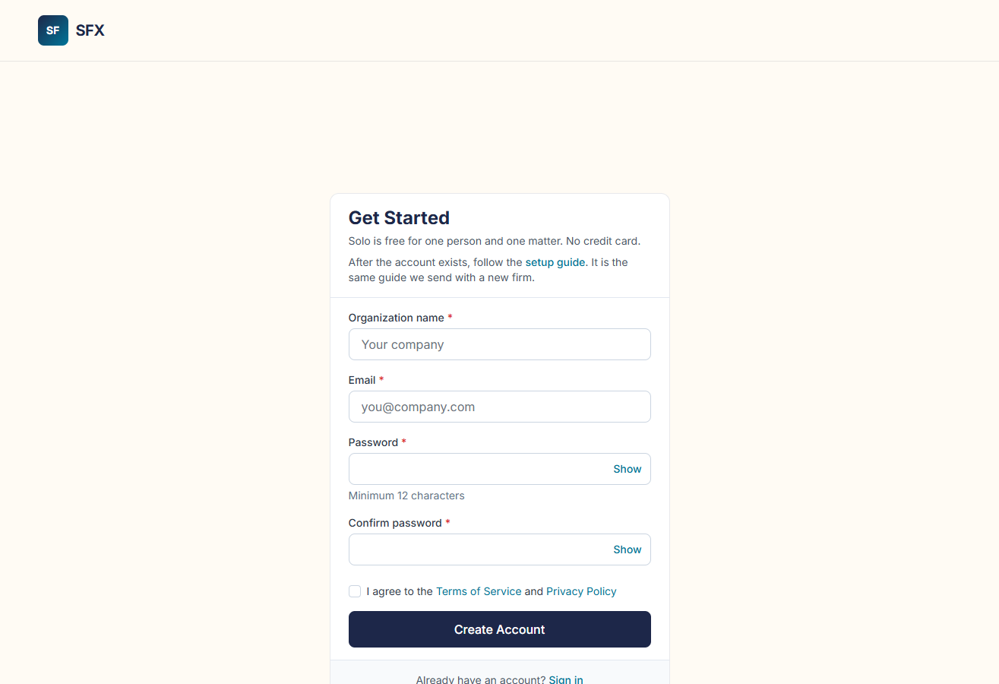

## Step 2. The three checks people skip

Frame 02.

If a check fails, the firm is not created. The picture shows three messages together:

Password must be at least 12 characters. Passwords do not match. You must agree to the terms and privacy policy.

Organization name and email are required as well. An email that already has an account is refused. Fix the red lines, then choose Create Account again.

**Easy to miss.** A short password and a mismatched confirmation are separate errors. Both have to be fixed. The terms box is easy to leave empty.

*On the picture: Red text under the password, under the confirmation, and under the terms checkbox.*

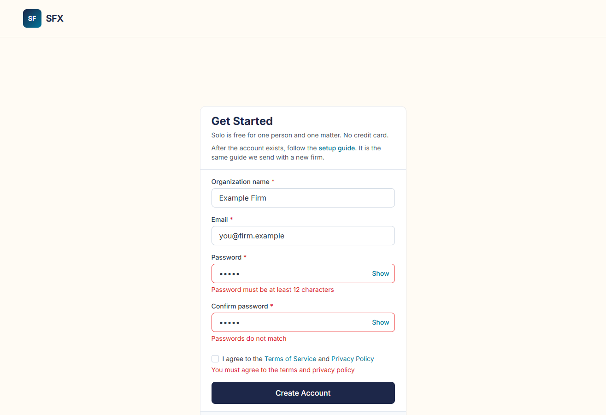

## Step 3. Sign in the next time

Frame 03.

Choose Sign in. Type the same email and password, then choose Sign In.

Remember me keeps the session on this browser.

Forgot password does not send an email. The reset page says that password reset is not available yet. Use the password from signup. If you still cannot sign in, email hello@securefileexchange.com from the address on the account.

**Easy to miss.** A person who was invited, and who has not opened the invite link, cannot sign in here. Their row still says Pending. That is step 16.

*On the picture: Welcome Back, the email and password boxes, Remember me, Forgot password, and Sign In.*

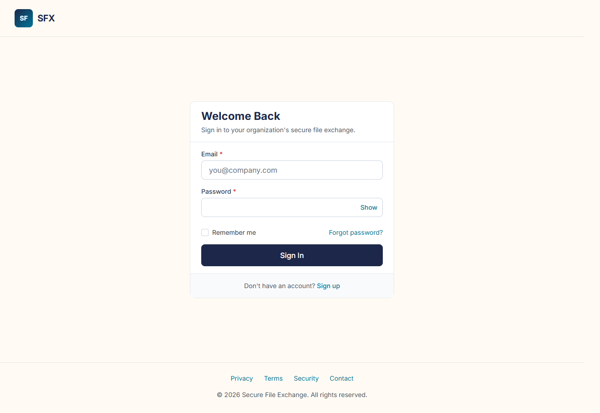

## Step 4. Read the dashboard first

Frame 04.

After sign-in you land on the dashboard. It counts open matters, documents waiting for approval, and documents filed this month.

Your firm name is at the top. Dark mode changes the signed-in pages only. The pictures in this guide are the light pages.

The counts in the picture belong to the example firm at the moment that picture was taken. Use the counts on your own dashboard.

**Easy to miss.** The dashboard is a summary. The waiting list itself is on Approvals, not on this count.

*On the picture: The three counts, the matters list, and the firm name at the top.*

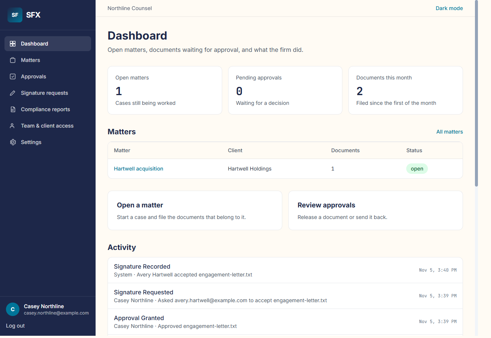

## Step 5. Open the matters list

Frame 05.

In the left column, choose Matters. These are the cases, and the documents that belong to them.

A new firm has an empty list and a button labeled Open matter. The example list already contains Hartwell acquisition.

**Easy to miss.** Documents are filed on a matter. There is no separate place to put a client file before a matter exists.

*On the picture: The left column with Matters selected, and the list of matters.*

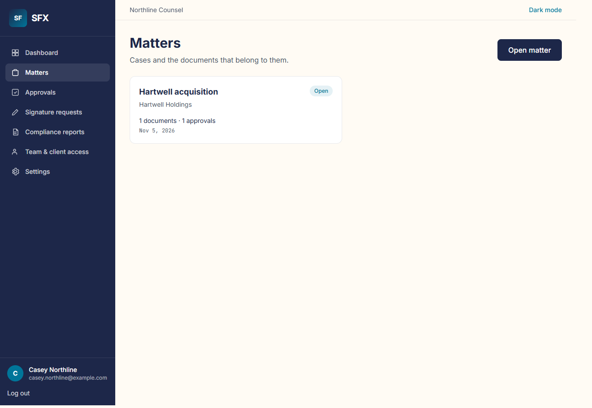

## Step 6. A matter needs both names

Frame 06.

Choose Open matter. Two boxes appear: Matter and Client. Both are required.

Type the matter name and the client name, then choose Create matter. The example uses Hartwell acquisition and Hartwell Holdings.

If either box is empty, the matter is not created.

**Easy to miss.** The client name is a separate box. A matter name alone is not enough.

*On the picture: The Matter box, the Client box, and Create matter.*

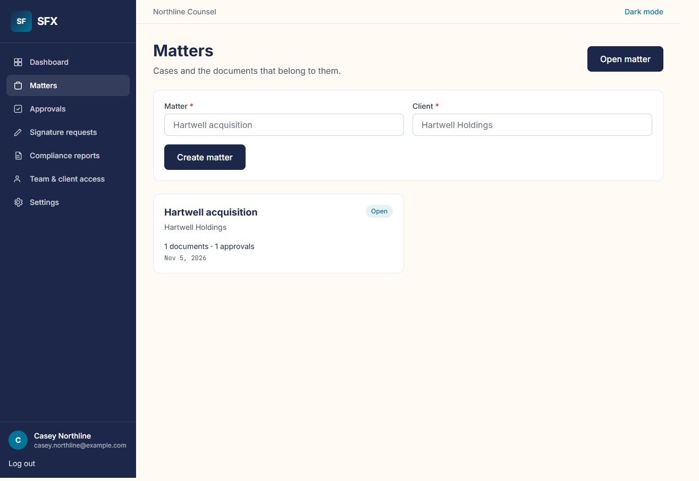

## Step 7. File the document

Frame 07.

Open the matter. Under Add a document, choose the file. Then choose File on this matter.

File on this matter stays gray until a file is chosen. The screen refuses a file larger than 6 MB.

Filing puts the document on the matter. It does not approve the document, and it does not send it to anyone. You can choose Download on the row to open your own copy.

**Easy to miss.** People stop at the gray button. Choose the file first. The button turns solid after a file is chosen.

*On the picture: Add a document, Choose File, the gray File on this matter button, and the document row under Documents.*

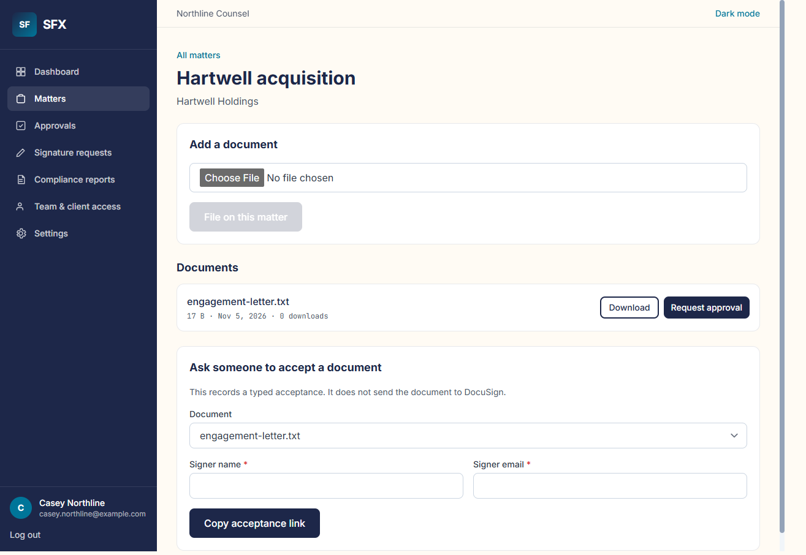

## Step 8. Ask someone at the firm to approve

Frame 07.

On the document row, choose Request approval. That adds a waiting decision on Approvals.

Request approval does not email anyone, and it does not send the file to the client.

The same page also has Ask someone to accept a document. Do not use that card yet. Acceptance comes after approval. That is step 10.

**Easy to miss.** Request approval and Copy acceptance link are different buttons. Filing the file is a third, earlier action.

*On the picture: The Request approval button on the engagement-letter.txt row. Leave the lower card for step 10.*

## Step 9. Approve it, or send it back

Frame 08.

Choose Approvals. A waiting document is marked pending and has Approve and Reject.

Approve means someone at the firm has released it for the next step. Reject leaves it on the matter and does not record client acceptance.

A row that is already approved or rejected has no buttons. It cannot be decided again from this screen.

The picture shows the example file twice: one row still pending, and an older row already approved. Your list shows only the decisions your firm has made.

**Easy to miss.** Approving is a person's decision on this screen. Uploading the file did not do it.

*On the picture: The pending row with Approve and Reject, and the older approved row with no buttons.*

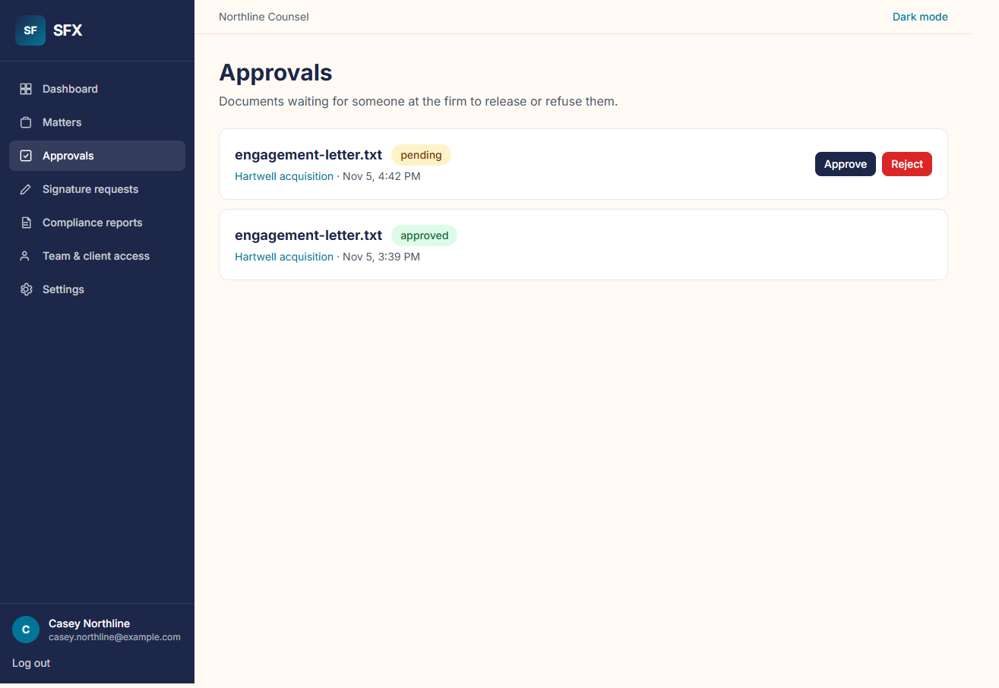

## Step 10. Copy the acceptance link after approval

Frame 07.

Go back to the matter. The lower card is Ask someone to accept a document. The card says this records a typed acceptance and does not send the document to DocuSign.

Choose the document. Type the signer name and the signer email. Both are required. Then choose Copy acceptance link.

The screen will let you copy a link even if Approvals does not say approved yet. Do not send the link until it does. No email goes out. Paste the link into your own message to the client.

**Easy to miss.** Signer name and signer email are both required. The link is copied to your clipboard. It is not mailed.

*On the picture: The lower card: the document menu, signer name, signer email, and Copy acceptance link.*

## Step 11. What the client sees

Frame 17.

The client does not need an account. The page is titled Accept this document. It names your firm, the file, the matter, and the client.

They type their name and choose Record acceptance. The page says this is not a DocuSign ceremony.

A name shorter than two characters is refused. Send the client the link from your own screen, plus the short note at the end of this guide.

**Easy to miss.** The name in the picture was filled in for the example and was not submitted. The client still has to choose Record acceptance.

*On the picture: Accept this document, the name box, the sentence about DocuSign, and Record acceptance.*

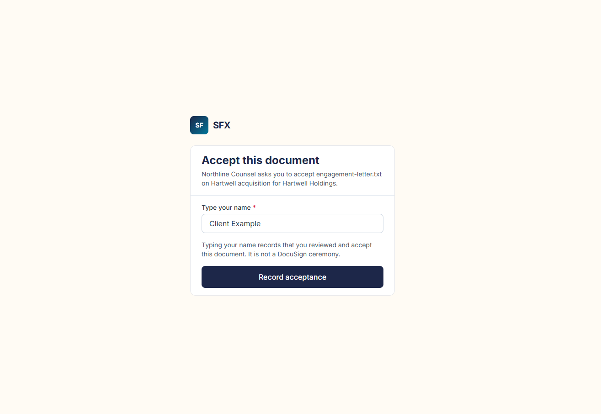

## Step 12. The client is finished when this sentence appears

Frame 18.

After a real submission, the page says Your acceptance is recorded.

There is no separate signed-PDF download on this screen. The record is the typed name, the time, and the document they were shown.

The picture is an example that was already recorded, for Avery Hartwell on the same kind of page. A second submission on a finished link is refused.

**Easy to miss.** Closing the tab before this sentence appears means the acceptance was not recorded.

*On the picture: The green line: Your acceptance is recorded.*

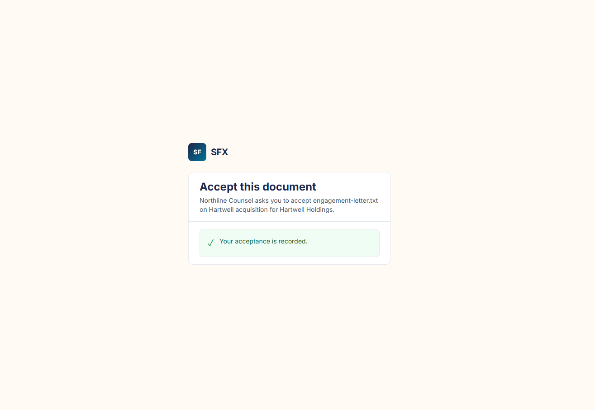

## Step 13. The firm sees the acceptance

Frame 09.

Choose Signature requests. A finished request is marked signed. The row names the document, the signer, the email you entered, the matter, the time, and the name they typed.

The page says DocuSign is not connected. A link that has not been submitted stays unsigned. It does not appear as signed just because you copied it.

**Easy to miss.** The signed row is the firm's copy of the record. The client does not get a certificate file from their page.

*On the picture: The signed badge, the typed name, and the line that DocuSign is not connected.*

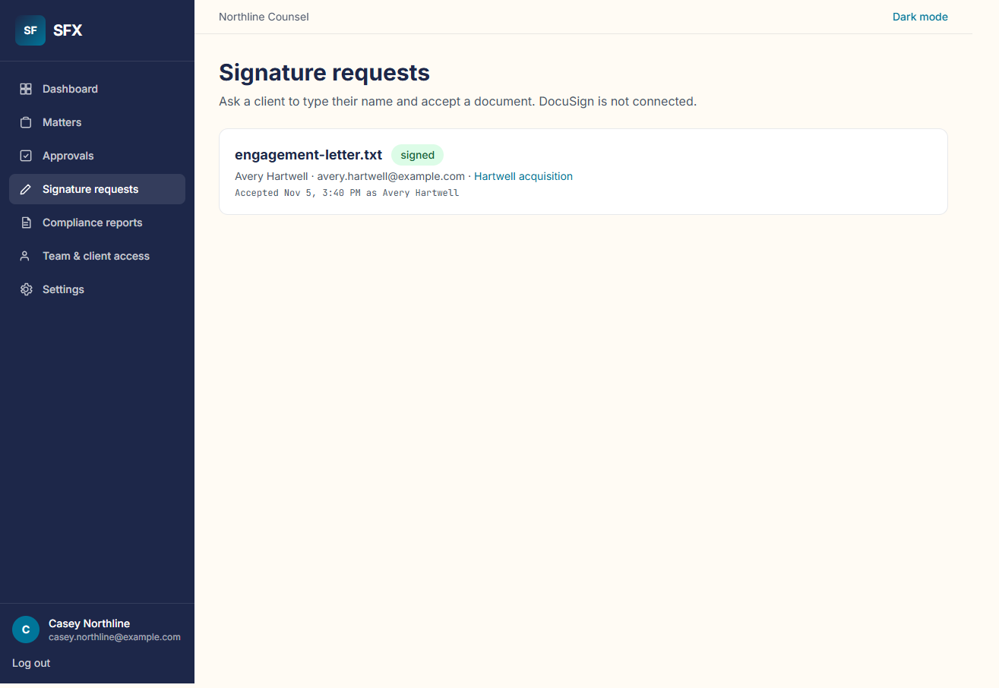

## Step 14. See who can enter the firm

Frame 11.

Choose Team and client access. The person who created the firm is the Owner and cannot be removed on this page.

Admin can manage people and settings. Member can work with the organization's files.

The names in the picture are the example firm. Your list should contain only your people.

**Easy to miss.** A client who only needs to accept one document does not need a seat here. Send them the acceptance link from step 10.

*On the picture: The people table, the role names, and the Roles note at the bottom.*

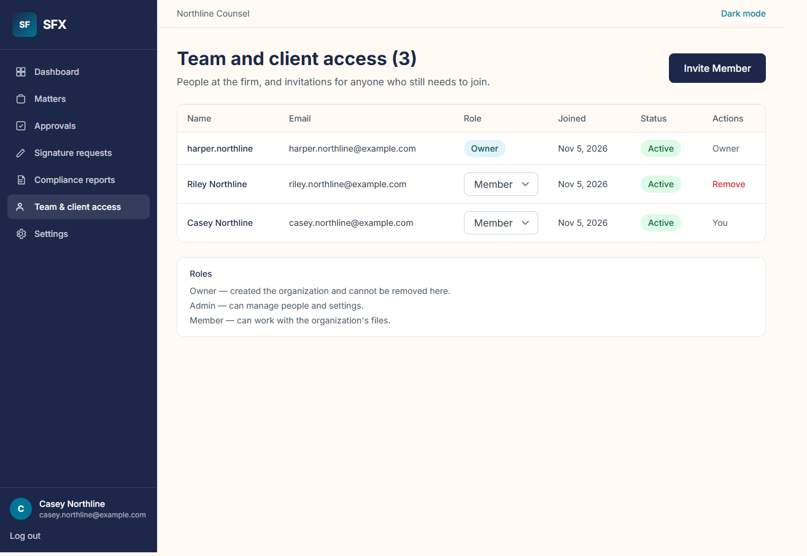

## Step 15. Invite a person

Frame 12.

Choose Invite Member. Type their email. Choose Member or Admin. Then choose Send Invite.

Member is the right role for someone who should work on files. Admin is for someone who should manage people, settings, and the plan. You do not invite a second Owner.

**Easy to miss.** Send Invite only creates the invitation. It does not deliver a message. The next step is the part people miss.

*On the picture: The email box, the role menu set to Member, and Send Invite.*

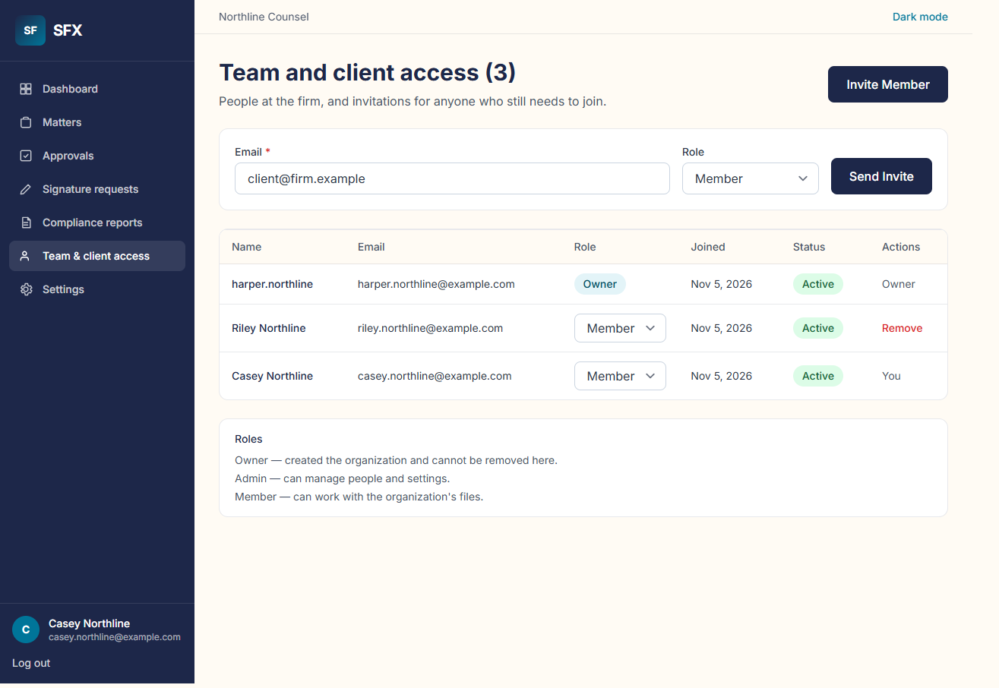

## Step 16. No email is sent

Frame 13.

The green notice says no email is sent, and tells you to share the link. Choose Copy link and paste it into your own message.

Until that person opens the link and creates a password, the row stays Pending. A pending person cannot sign in.

The link in the picture is the example firm's link. Copy the link on your screen. Do not type the address out of the picture.

**Easy to miss.** Pending means they have not joined. It does not mean an email is on the way.

*On the picture: The green notice, the link box, Copy link, and the Pending badge on the new row.*

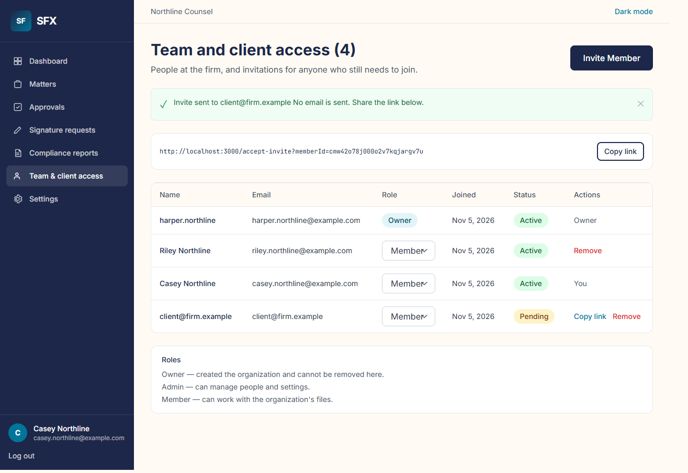

## Step 17. They join by setting a password

Frame 14.

Their link opens Accept invitation. It names the firm and the email you invited.

They type their name, a password of at least 12 characters, and the same password again. Then they choose Create account and join.

If the password is short, or the two boxes differ, the account is not created. After they join, their row changes from Pending to Active, and they can sign in.

**Easy to miss.** The picture stops before the button is pressed. Leave the password boxes empty when you show someone this page. Do not put a real password in a screenshot.

*On the picture: Your name, both password boxes, Minimum 12 characters, and Create account and join.*

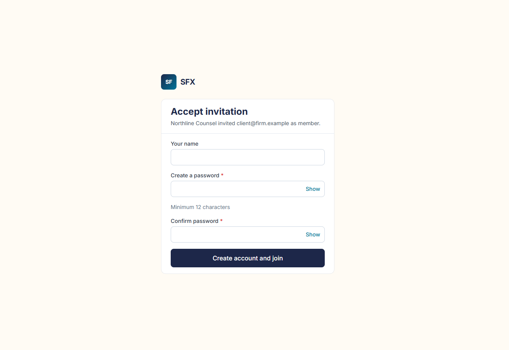

## Step 18. Keep the activity record

Frame 10.

Choose Compliance reports. The list shows who opened a matter, filed a document, requested approval, approved or rejected it, invited someone, and recorded an acceptance.

This is the firm's activity record. It is not a certification, and it is not a legal opinion about the document.

**Easy to miss.** The newest lines are at the top. A missing line means that action was not recorded, not that the report failed to load a certificate.

*On the picture: The sentence under the title, then the dated lines for approvals, the acceptance, the upload, and the invites.*

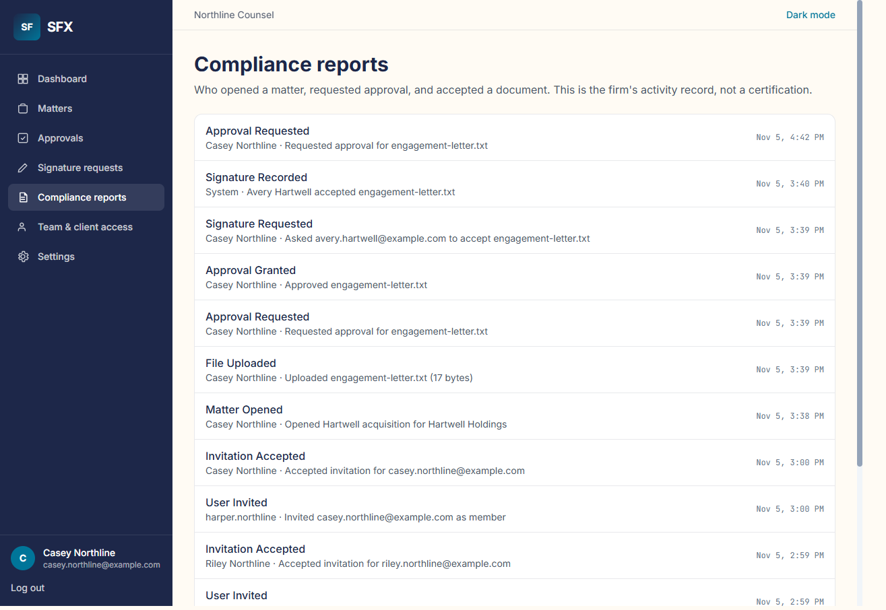

## Step 19. Settings, and the switches that are only saved

Frame 15.

Choose Settings, then General. The organization name is saved and shows at the top of the signed-in pages.

Default expiration days accepts a whole number from 1 to 365, and Max downloads per file is saved on this form. A newly filed document is still kept for 30 days and can be downloaded 100 times. Changing these numbers does not change that yet.

Require password protection, Enable two-factor auth, and Email notifications are saved when you choose Save changes. They do not add a download password, a second code at sign-in, or an email. Leave them as they are during setup. Do not tell a client those controls are protecting the file.

Do not choose Delete Organization while you are setting up. That removes the firm and the files under it. The confirm box asks you to type DELETE.

**Easy to miss.** Save changes stores the form. It does not turn on email or a second sign-in code.

*On the picture: Organization name, the two number boxes, the three switches, and the start of Notifications. Delete Organization sits further down and is not part of setup.*

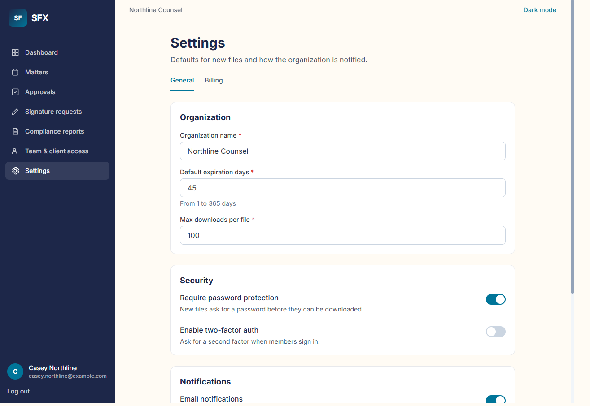

## Step 20. Leave billing until you mean to pay

Frame 16.

Choose Settings, then Billing. This example firm is still on Trial, so the screen shows Use Solo. A new firm starts on Solo. Solo is free for one person and one open matter. No card is on file.

Use Solo moves a trial firm onto that free plan. Starter is $29 a month for 3 people. Business is $149 a month for 15 people. Enterprise is arranged from Contact us.

After a firm subscribes, this same page shows Cancel subscription. Canceling stops the next charge and moves the firm to Solo. Documents already filed stay. The buttons on this picture are available because the signed-in person is an owner. A member sees them gray.

You do not need a card to open the first matter.

**Easy to miss.** Cancel subscription is not on this picture. It appears after the firm is on Starter or Business. A gray button means the signed-in person is not an owner or an admin.

*On the picture: The Trial card, Solo at $0 with Use Solo, Starter at $29, Business at $149, and Enterprise at Custom.*

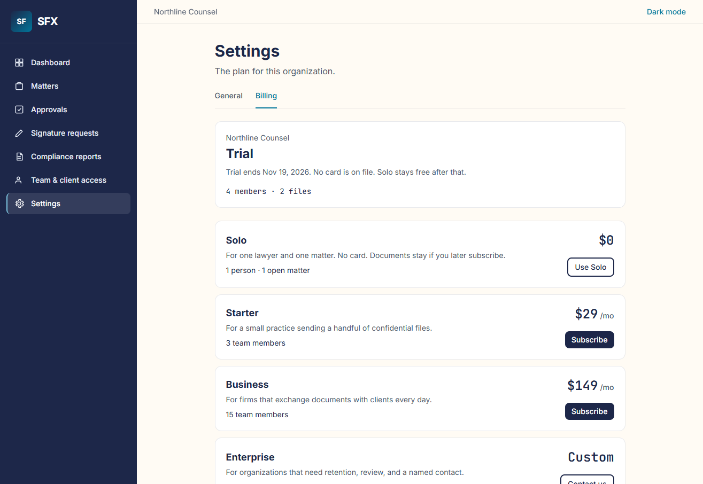

## Note to send with the acceptance link

Paste this with the link you copied. Replace the bracketed words.

Please open this link and accept [document name] for [matter name]. The page names our firm and the document. Type your name and choose Record acceptance. You are finished when the page says Your acceptance is recorded. This is a typed acceptance. It is not a DocuSign ceremony. You do not need an account.
